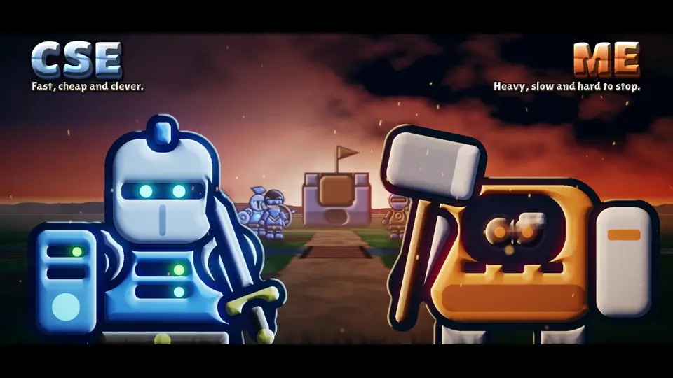
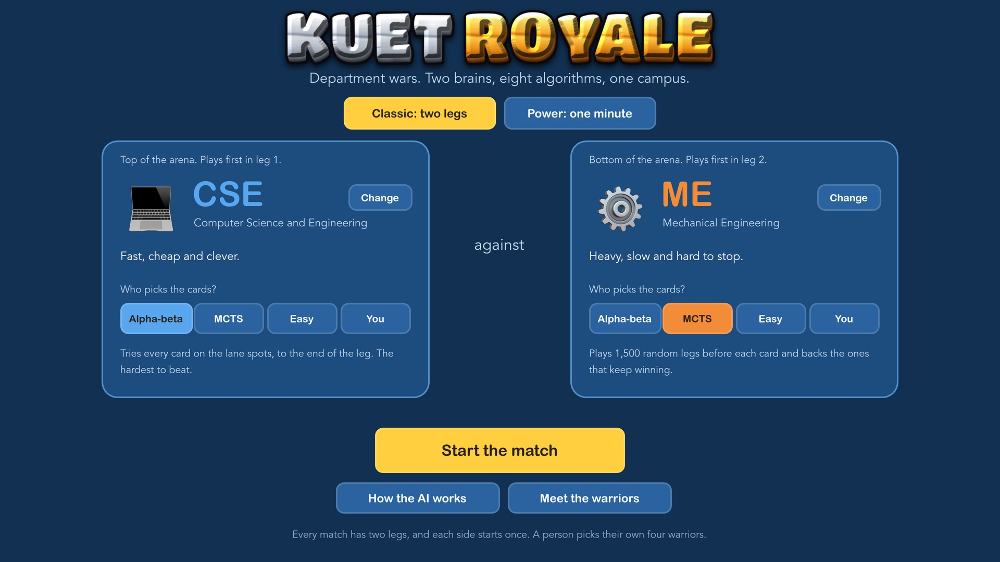
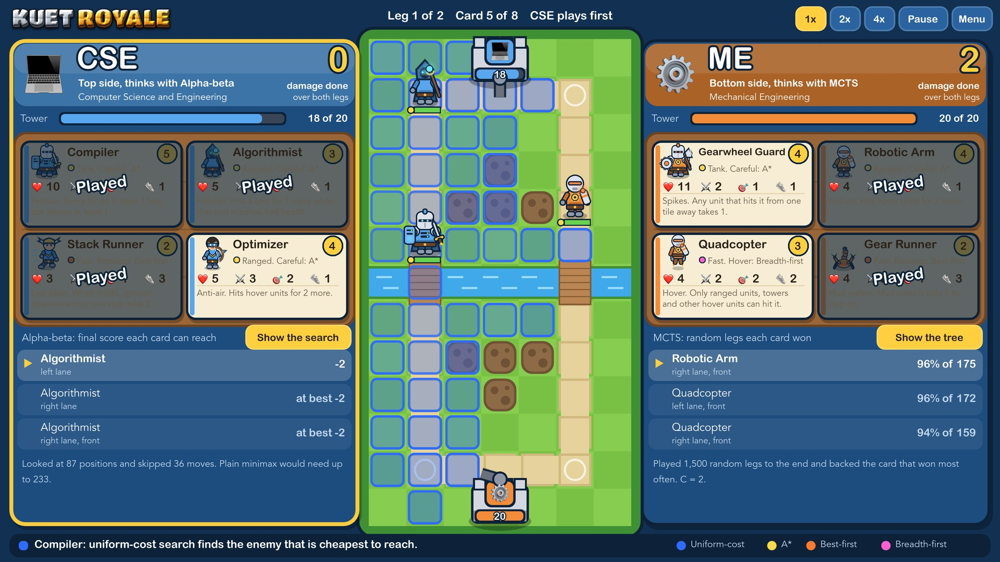
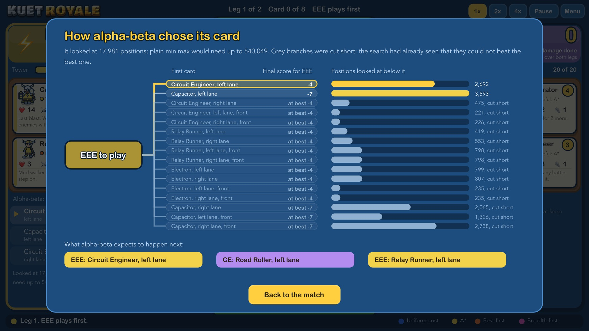
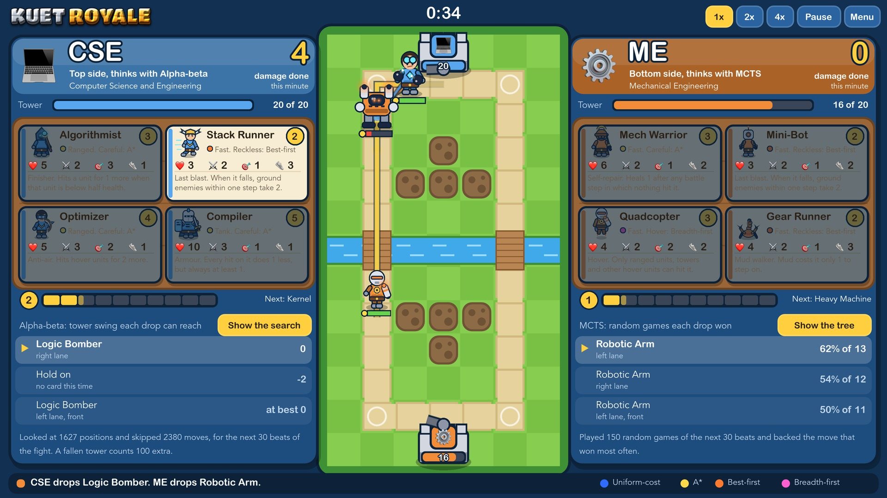
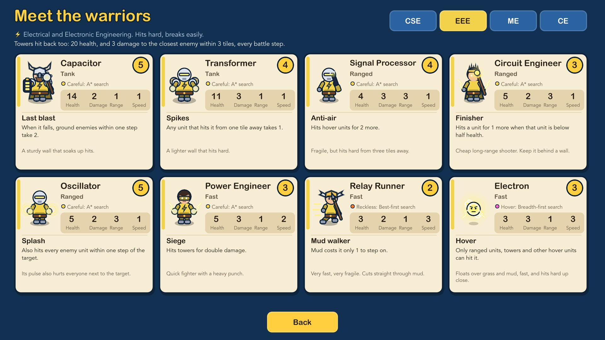
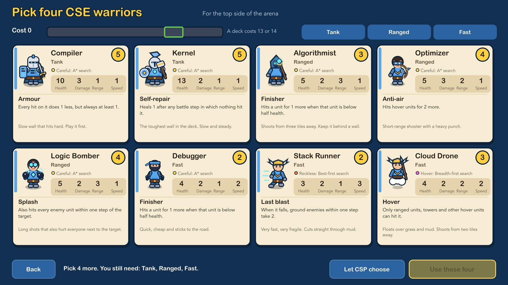
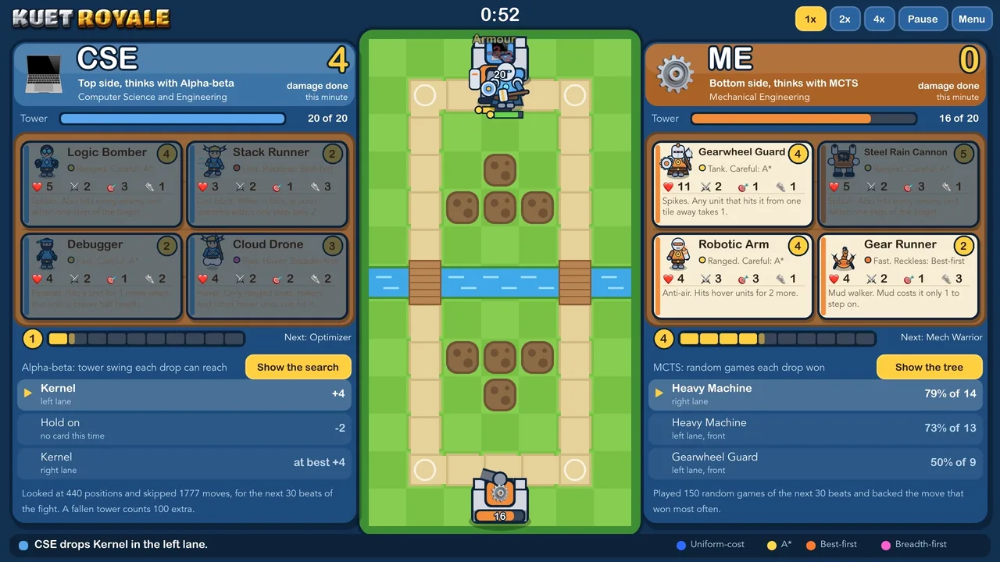

# KUET Royale: Department Wars

<p align="center">
  
</p>

<p align="center">
  <b><a href="media/KUET-Royale-film.mp4">Watch the 60-second film</a></b> (720p, 11 MB). The game opens with it, and <b>Skip</b> goes straight to the menu.
</p>

### Screenshots

| | |
|---|---|
|  |  |
| **Home.** Pick two departments, who thinks for each side, and the mode. | **A classic match.** Each side plays a card in turn, and the units fight on their own. |
|  |  |
| **Show the tree.** Any decision a brain made, opened as a tree. | **Power mode.** One minute, coins that refill, and no turns. |
|  |  |
| **Meet the warriors.** Every warrior of every department, with its numbers and its special. | **The troop picker.** A person picks their own four, under the cost and role limits. |

### Gameplay

<p align="center">
  
</p>

Ten seconds of a real Power match at normal speed: CSE (alpha-beta) against ME (MCTS). Nothing in it is staged.

---

A small strategy game where two KUET departments fight across a campus battlefield, and two different AI algorithms do the thinking. It is the course project for CSE 3210: Artificial Intelligence Lab.

| | |
|---|---|
| **Status** | Built and playable: the Godot game with 32 warrior figures, the classic game in the terminal, a balance checker, automated tests and a scripted player that clicks through every screen. See [what is and is not checked](#15-what-is-and-is-not-checked). |
| **Must have** | AI against AI, fun to watch. Built. |
| **Bonus** | A person against an AI. Built. |
| **Departments** | CSE, EEE, ME and CE |
| **Team** | Two students |
| **Numbers** | Every figure in this file comes from `ai/balance_check.py` or the tests, run on 31 October 2026 |

---

## 1. The game in one minute

1. Two departments face each other. Each has one **tower** and brings **four cards**. Every card is one unit.
2. They take turns. On your turn you drop one card on a tile of your half of the arena.
3. Units then walk and fight by themselves. Whoever does more damage to the enemy tower wins.

That is the whole game. Nobody steers a unit after it is played. All the thinking is in three choices: which card, where, and in what order.

One department thinks with **alpha-beta search**. The other thinks with **Monte Carlo Tree Search**. So every match is also one algorithm against another. You can also take a side yourself. There is also a one-minute **Power mode** with no turns (section 5).

### How to play

The game opens with a 60-second film. Click **Skip**, or press Esc, Space or Enter, to go straight to the menu.

1. In the menu, pick two departments and who thinks for each: **Alpha-beta** (the hardest), **MCTS**, **Easy** (MCTS with only 100 random legs a card) or **You**. Leave both on an AI to watch.
2. If you chose **You**, pick your own four warriors on the troop picker. It shows the cost so far and what is still missing, and **Let CSP choose** picks a legal deck for you.
3. On your turn, **click one of your cards**, then **click any tile** on your half of the arena.
4. Stuck? **Hint** asks alpha-beta for the best card and place. Your first match is a guided one: a coach points out what to click.
5. **1x, 2x, 4x**, **Pause** and **Step** let you stop on any move and explain it.

**Meet the warriors** on the home screen shows every warrior of every department with all their numbers and their special.

### Two legs

A match is played twice, like a home and away tie in football. In the first leg the left side plays first; in the second leg the right side does. The damage from both legs is added.

The reason is measured, not guessed: the side that plays second can always answer the other side's card. With both sides on alpha-beta it comes out about 2 points ahead in a single leg (section 14). Two legs give each side that edge once.

---

## 2. How a leg works

| Step | What happens | Who decides |
|---|---|---|
| 1. Deck building | Each department's four cards are chosen from its roster of eight. | CSP solver, or a person on the troop picker |
| 2. Card turn | The side to play drops one unused card on a tile of its half. There is no passing. | Alpha-beta, MCTS or a person |
| 3. Battle steps | The battle runs for 3 steps. | The rules |
| 4. Repeat | Steps 2 and 3 alternate until all eight cards are played. | |
| 5. Final battle | After the last card the battle runs for up to 15 more steps, or until no unit is left. | The rules |
| 6. Result | Each side's score is the damage it did to the enemy tower. | |

Both decks lie face up the whole time. Nothing is hidden and nothing is random in the rules.

### What one unit does in one battle step

Every unit does exactly one thing per step:

1. **Is an enemy in range?** Then attack. If several are in range, the fuzzy system picks which one.
2. **Otherwise, pick where to go.** The destination is the enemy unit, or the tile next to the enemy tower, that is cheapest to reach.
3. **Walk.** The unit gets `speed` movement points. Stepping onto a tile costs that tile's price. Points it cannot spend yet are saved for the next step, so a speed-1 unit needs two steps to enter grass and four to enter mud. It stops as soon as an enemy is in range.

Towers fight too. Each step a tower fires at the closest enemy within 3 tiles for 3 damage. A hover unit is not safe from it.

### Where a card can drop

A person may drop on any tile of their half that can be walked on, 41 tiles in all. The brains choose from fewer, so that alpha-beta can still reach the end of the leg: the move being chosen tries the two lane starts and the front of the two lanes by the bridges, and every move deeper in the search tree uses the two lane starts only.

All attacks in a step are worked out from where everything stood at the start of the step, and they land together. So the order units are processed in never favours one side.

Several units may stand on the same tile. That avoids traffic-jam rules.

### The numbers

| Rule | Value |
|---|---|
| Tower health | 20 |
| Tower range and damage | 3 tiles, 3 per step |
| Battle steps after each card | 3 |
| Extra battle steps after the last card | up to 15 |
| Cards per deck | 4 |
| Deck cost | 13 or 14 |

---

## 3. The battlefield

A grid 13 tiles wide and 7 tall, as stored in `ai/data/map.json`: left department on the left, right department on the right, a river down the middle.

**On screen the arena stands upright:** the left department is at the top, the right department at the bottom, and what the map file calls the top lane is the lane on the left. Only the drawing is turned; the rules never change. The map is a mirror image, and a unit on the right tries its steps in the mirror order of a unit on the left, so a position and its mirror image always play out the same way (a test checks this).

```
       0  1  2  3  4  5  6  7  8  9  10 11 12
row 0  .  .  .  .  .  .  ~  .  .  .  .  .  .
row 1  .  S  =  =  =  =  B  =  =  =  =  S  .     top lane
row 2  .  =  .  .  m  .  ~  .  m  .  .  =  .
row 3  T  =  .  m  m  .  ~  .  m  m  .  =  T
row 4  .  =  .  .  m  .  ~  .  m  .  .  =  .
row 5  .  S  =  =  =  =  B  =  =  =  =  S  .     bottom lane
row 6  .  .  .  .  .  .  ~  .  .  .  .  .  .
```

| Mark | Tile | Cost to step onto it |
|---|---|---|
| `=` | Road | 1 |
| `B` | Bridge | 1 |
| `S` | Start tile of a lane (road) | 1 |
| `.` | Grass | 2 |
| `m` | Mud | 4 |
| `~` | River | Cannot be crossed |
| `T` | Tower | Cannot be entered. A unit hits it from anywhere within its range, so a melee unit must stand next to it |

Costs are whole numbers on purpose, so every path cost on screen can be checked by hand.

A worked example you can check on the map: from (3,1) to (3,5).

| Search | Route | Cost |
|---|---|---|
| A* | Round by the road through (1,1) and (1,5) | 8 |
| Best-first | Straight down: grass, mud, grass, road | 9 |
| Breadth-first (hover) | Straight down, 4 steps | 4 steps |

---

## 4. Cards and units

### The six numbers on a card

| Number | Meaning |
|---|---|
| Cost | The limit when building a deck, and the price in coins in Power mode. |
| Health | Damage it can take before it is removed. |
| Damage | Health it removes per attack. |
| Range | How many tiles away it can hit (counted as steps left/right/up/down). Range ignores terrain, so shooting over the river is allowed. |
| Speed | Movement points per battle step. |
| Role | Tank, Ranged or Fast. Used by the deck builder. |

### How a unit walks

Each unit has one walking style. This is the heart of the pathfinding part of the project.

| Style | What it means | Algorithm |
|---|---|---|
| Careful (most units) | Takes the cheapest route, counting road, grass and mud. | A* |
| Reckless | Heads straight at the goal and may wade through mud. | Best-first search |
| Hover | Floats, so every tile costs 1. Fewest steps wins. | Breadth-first search |

### One special each

Every warrior has exactly one special. It is one short rule.

| Special | What it does |
|---|---|
| Hover | Only ranged units, towers and other hover units can hit it. Melee units on the ground walk past it. |
| Splash | Also hits every enemy unit within one step of the target. The area is found with breadth-first search. A hover unit is hit only if the attacker could hit it anyway. |
| Armour | Every hit on it does 1 less, but always at least 1. |
| Self-repair | Heals 1 after any battle step in which nothing hit it. |
| Finisher | Hits a unit for 1 more when that unit is below half health. |
| Anti-air | Hits hover units for 2 more. |
| Last blast | When it falls, ground enemies within one step take 2. |
| Spikes | Any unit that hits it from one tile away takes 1. |
| Siege | Hits towers for double damage. |
| Mud walker | Mud costs it only 1 to step on. |

No spells and no buildings. A new card is a new row of numbers in a JSON file, and it names its own special.

### The four rosters

**CSE: fast, cheap and clever.**

| Card | Cost | Health | Damage | Range | Speed | Walks | Special | Role |
|---|---|---|---|---|---|---|---|---|
| Compiler | 5 | 10 | 3 | 1 | 1 | Careful | Armour | Tank |
| Kernel | 5 | 13 | 2 | 1 | 1 | Careful | Self-repair | Tank |
| Algorithmist | 3 | 5 | 2 | 3 | 1 | Careful | Finisher | Ranged |
| Optimizer | 4 | 5 | 3 | 2 | 1 | Careful | Anti-air | Ranged |
| Logic Bomber | 4 | 5 | 2 | 3 | 1 | Careful | Splash | Ranged |
| Debugger | 2 | 4 | 2 | 1 | 2 | Careful | Finisher | Fast |
| Stack Runner | 2 | 3 | 2 | 1 | 3 | Reckless | Last blast | Fast |
| Cloud Drone | 3 | 4 | 2 | 2 | 2 | Hover | Hover | Fast |

**EEE: hits hard, breaks easily.**

| Card | Cost | Health | Damage | Range | Speed | Walks | Special | Role |
|---|---|---|---|---|---|---|---|---|
| Capacitor | 5 | 14 | 2 | 1 | 1 | Careful | Last blast | Tank |
| Transformer | 4 | 11 | 3 | 1 | 1 | Careful | Spikes | Tank |
| Signal Processor | 4 | 4 | 3 | 3 | 1 | Careful | Anti-air | Ranged |
| Circuit Engineer | 3 | 5 | 2 | 3 | 1 | Careful | Finisher | Ranged |
| Oscillator | 5 | 5 | 2 | 3 | 1 | Careful | Splash | Ranged |
| Power Engineer | 3 | 5 | 3 | 1 | 2 | Careful | Siege | Fast |
| Relay Runner | 2 | 3 | 2 | 1 | 3 | Reckless | Mud walker | Fast |
| Electron | 3 | 3 | 3 | 1 | 3 | Hover | Hover | Fast |

**ME: heavy, slow and hard to stop.**

| Card | Cost | Health | Damage | Range | Speed | Walks | Special | Role |
|---|---|---|---|---|---|---|---|---|
| Heavy Machine | 5 | 12 | 2 | 1 | 1 | Careful | Armour | Tank |
| Gearwheel Guard | 4 | 11 | 2 | 1 | 1 | Careful | Spikes | Tank |
| Robotic Arm | 4 | 4 | 3 | 3 | 1 | Careful | Anti-air | Ranged |
| Steel Rain Cannon | 5 | 5 | 2 | 3 | 1 | Careful | Splash | Ranged |
| Mech Warrior | 3 | 6 | 2 | 1 | 2 | Careful | Self-repair | Fast |
| Gear Runner | 2 | 4 | 2 | 1 | 3 | Reckless | Mud walker | Fast |
| Mini-Bot | 2 | 3 | 2 | 1 | 2 | Reckless | Last blast | Fast |
| Quadcopter | 3 | 4 | 2 | 2 | 2 | Hover | Hover | Fast |

**CE: slow to arrive, slower to leave.**

| Card | Cost | Health | Damage | Range | Speed | Walks | Special | Role |
|---|---|---|---|---|---|---|---|---|
| Excavator | 5 | 15 | 2 | 1 | 1 | Careful | Siege | Tank |
| Road Roller | 4 | 12 | 2 | 1 | 1 | Reckless | Mud walker | Tank |
| Site Engineer | 3 | 5 | 2 | 3 | 1 | Careful | Self-repair | Ranged |
| Crane Operator | 4 | 6 | 3 | 2 | 1 | Careful | Anti-air | Ranged |
| Seismic Crew | 5 | 6 | 2 | 3 | 1 | Careful | Splash | Ranged |
| Surveyor | 2 | 5 | 2 | 1 | 2 | Careful | Finisher | Fast |
| Construction Crew | 2 | 3 | 2 | 1 | 3 | Reckless | Last blast | Fast |
| Survey Drone | 3 | 5 | 2 | 2 | 2 | Hover | Hover | Fast |

These numbers were tuned with the balance checker until the departments came out close (section 14).

### Deck rules

A deck is four cards from the department's eight:

- one **Tank**, one **Ranged**, one **Fast**, and one **free** slot (any card);
- no card twice;
- total cost of 13 or 14.

Example: Compiler (5) + Optimizer (4) + Debugger (2) + Stack Runner (2) = 13.

The CSP solver builds a brain's deck. A person picks on the troop picker, and the same rules are checked (`deck_from_picks`).

---

## 5. Winning

| Situation | Result |
|---|---|
| A tower reaches 0 health | The leg ends at once |
| A leg ends | Each side scores the damage it did to the enemy tower |
| Both legs are over | The side with more total damage wins the match |
| Same total | Draw |

Inside one leg, the number both AIs push their way is **left tower health minus right tower health at the end of the leg**. It is a real final score, read off a finished leg. It is not an estimate of an unfinished one.

After each leg the game names the **turning point**: the one card that cost its side the most, compared with what alpha-beta says was the best card at that moment.

### Power mode: one minute, no turns

A second way to play, in `ai/kuet_royale/power.py`. It feels like a real-time card battler.

| Rule | Value |
|---|---|
| Length | 100 beats of 0.6 seconds, one minute. One beat is one battle step. |
| Cards | All eight of the department. You hold four; a played card goes to the back of the queue and the next one comes in. |
| Coins | Start with 5, earn 1 every 3 beats, never more than 10. A card costs its cost. |
| Drops | A person may drop one card per beat on any tile of their half. A brain looks every second beat and picks a lane start or a lane front. Neither side waits for the other. |
| End | The clock runs out, or a tower falls. More damage to the enemy tower wins. |

Both brains are the same code as in the classic game; only the rules they are given change (`alpha_beta_decision(state, rules)`, `mcts(..., rules=...)`). A whole minute is far too big to search, so a brain looks at a **window** of the next 30 beats (18 seconds) and cuts its search off there. Classic alpha-beta has no evaluation function, but Power mode has to stop early, so the end of the window is scored with a very simple one: how much left tower minus right tower moved in that window, plus 100 for a fallen tower.

- **Alpha-beta** looks at four decisions (mine, the reply, mine, the reply), one beat apart, then lets the fight run to the end of the window. Waiting is tried first, so it spends coins only when a drop really changes the score.
- **MCTS** plays 150 random games of the window before each decision (30 on Easy).
- A brain decides every second beat, and only when it could pay for any card in its hand. Otherwise it would spend its coins on cheap cards and never play the dear ones. Both brains decide on the same beats, from the same position, so they can drop together.
- All eight are in rotation, so all eight come to hand, but a brain still chooses. It does not always play all eight in a minute (section 14).

Because Python is run once per beat, the screen asks for the next beat as soon as the last one starts to play. A person's drop is shown at once as a ring on the tile, and its coins are taken at once.

---

## 6. The AI: eight algorithms, eight jobs

Every algorithm answers one clear question. All eight were taught in the course.

| # | Algorithm | The question it answers | Runs when | Taught in | Where in the code |
|---|---|---|---|---|---|
| 1 | A* | What is the cheapest route to that tile? | A careful unit gets a destination | Lab 03 | `search.py` |
| 2 | Best-first search | Which way looks closest to the goal? | A reckless unit gets a destination | Lab 03 | `search.py` |
| 3 | Breadth-first search | What is the fewest-steps route? Which tiles are within 1 step? | A hover unit moves; a splash attack lands | Course | `search.py` |
| 4 | Uniform-cost search | Which enemy is cheapest to reach? | A unit has nobody in range | Course | `search.py` |
| 5 | Fuzzy inference | Several enemies are in range. Which one do I hit? | A unit attacks | Lab 05 | `fuzzy.py` |
| 6 | Alpha-beta search | Which card and place give the best final score? | One department's card turn | Theory (built on Lab 04 minimax) | `alphabeta.py` |
| 7 | Monte Carlo Tree Search | Which card and place win most often in play-outs? | The other department's card turn | Lab 08 | `mcts.py` |
| 8 | CSP backtracking | Which four cards make a legal deck? | Once, before the match | Lab 06 | `deck_csp.py` |

For numbers 3 and 4, write down whether each was in the lab or the theory class, so the answer is ready in the viva.

### 6.1 A* (careful units)

- **Score of a tile:** `f = g + h`. `g` is the terrain cost walked so far. `h` is the straight step count to the goal (Manhattan distance).
- **Why the answer is the cheapest route:** the cheapest tile costs 1, so `h` never says more than the true remaining cost.
- **Checked:** on 300 random pairs of tiles A* returns exactly the cost uniform-cost search returns, and never explores more tiles.
- **Say in the viva:** "A* finds the cheapest route because it adds what it has already paid to an honest guess of what is left."

### 6.2 Best-first search (reckless units)

- **Score of a tile:** `f = h` only. It ignores what it has already paid.
- **Effect:** quick and direct, but it will happily walk into mud. The game says so when it happens: "Stack Runner takes the greedy route: it costs 25 where A* would pay 12."
- **Say in the viva:** "Best-first is greedy. Put a Stack Runner next to a Debugger and you can see greedy against optimal on the same map."

### 6.3 Breadth-first search (hover units and splash)

- **Hover routing:** a hover unit pays 1 for every tile, so the best route is the one with the fewest steps. Breadth-first search explores one step further each round, so the first time it reaches the goal is the fewest-steps route.
- **Splash area:** start at the target tile and spread out one step. Every enemy on those tiles is hurt.
- **Say in the viva:** "When every step costs the same, breadth-first search already gives the shortest path. No priority queue is needed."

### 6.4 Uniform-cost search (choosing a destination)

- **The problem:** a unit must go to the nearest enemy, but it does not yet know which enemy that is. There are several possible goals: every enemy unit, and the tiles next to the enemy tower.
- **How:** spread out from the unit in order of total travel cost. The first goal tile taken off the queue is the destination.
- **Why not A\*:** A* needs one known goal to aim its guess at. Here there is no single goal yet.
- **Say in the viva:** "Uniform-cost search expands the cheapest tile first, so the first enemy it reaches is the cheapest enemy to reach."

(Hover units ignore terrain cost, so they use breadth-first search for this step as well.)

### 6.5 Fuzzy inference (choosing a target)

Used only when a unit has more than one enemy in range. Done the way Lab 05 does it by hand: straight-line shapes, OR means take the larger, clip each output shape, combine, and take the centre of the area over sample points. No library. The lab's own tip example (service 3, food 6, tip about 16) is reproduced in the tests.

- **Inputs:** how far the enemy is, in tiles (near, medium, far), and how much health it has left, in percent (low, medium, full).
- **Output:** attack priority from 0 to 100. The unit hits the enemy with the highest number.

The whole rule base is three rules:

```
IF distance is near    OR  health is low     THEN priority is high
IF distance is medium  OR  health is medium  THEN priority is medium
IF distance is far     OR  health is full    THEN priority is low
```

The shapes, all straight lines:

| Variable | Term | Corner points (value, degree) |
|---|---|---|
| Distance (0 to 4 tiles) | near | (0, 1) (2, 0) |
| | medium | (0, 0) (2, 1) (4, 0) |
| | far | (2, 0) (4, 1) |
| Health (0 to 100 %) | low | (0, 1) (50, 0) |
| | medium | (0, 0) (50, 1) (100, 0) |
| | full | (50, 0) (100, 1) |
| Priority (0 to 100) | low | (0, 1) (25, 1) (45, 0) |
| | medium | (25, 0) (50, 1) (75, 0) |
| | high | (55, 0) (75, 1) (100, 1) |

One case worked by hand: an enemy 1 tile away with half its health left. Near = 0.5, medium distance = 0.5, far = 0. Low = 0, medium health = 1, full = 0. So high = max(0.5, 0) = 0.5, medium = max(0.5, 1) = 1, low = 0. The centre of the combined shape is 63.5.

- **Say in the viva:** "Finish off what is close and nearly dead. Fuzzy logic lets 'close' and 'nearly dead' be matters of degree instead of hard cut-offs."

### 6.6 Alpha-beta search (one department's brain)

- **A move** is a pair: (card, spot). The move being chosen tries four spots; every move below it in the tree tries the two lane starts.
- **Shape:** the Lab 04 minimax program (`State`, `actions`, `result`, `terminal`, `utility`, `max_value`, `min_value`) with the two extra values alpha and beta from the theory class.
- **It searches to the very end of the leg.** There is no depth limit and no evaluation function. `utility` is the tower health difference of a finished leg.
- **Pruning:** when a branch cannot change the final choice, it is skipped. The screen counts skipped moves.
- **Checked:** the tests compare it with plain minimax written as in Lab 04. The two always give the same score.
- **Measured:** for the first card of a leg it looks at about 23,600 positions, where plain minimax would need up to 540,049. That takes about 0.6 seconds.
- **Say in the viva:** "Alpha-beta returns exactly what plain minimax would return. It only skips branches that cannot matter."

### 6.7 Monte Carlo Tree Search (the other department's brain)

Exactly the four steps on the Lab 08 slides:

1. **Select** by UCB1: `t/n + C * sqrt(ln N / n)` with `C = 2`.
2. **Expand** all moves of a visited leaf.
3. **Roll out:** play random legal cards to the end of the leg.
4. **Back up:** add 1 to `n` and the result to `t` on the way up.

It repeats this 1,500 times per card, which takes about 0.2 seconds. Nothing was added for the opponent, because the slides teach nothing about one. So this brain imagines the other side will be helpful. It gambles, and that is why alpha-beta usually beats it.

- **Say in the viva:** "MCTS never looks at every line. It plays many random legs and spends more of them on the cards that keep doing well."

### 6.8 CSP backtracking (deck building)

- **Variables:** the four deck slots (Tank, Ranged, Fast, Free).
- **Domains:** the roster cards allowed in each slot.
- **Constraints:** all four different; total cost 13 or 14.
- **Search:** backtracking as in Lab 06, with **MRV** (fill the slot that has the fewest cards left to choose from) and **LCV** (try the card that leaves the other slots the most choices).
- **Honest note:** with the CSE, ME and CE rosters MRV and LCV never had to take a card back in 500 builds. EEE needs it in about one build in six, because it has only one card that costs 2. A test also builds a small roster where it must.
- **Say in the viva:** "A deck is a small constraint problem. The two orderings are there so the solver rarely walks into a dead end."

### 6.9 Why the game is this small

Alpha-beta has to reach the end of the leg, so the leg must be short.

- First card: 4 cards x 4 spots = 16 choices. Then 8 for the other side (4 cards x 2 lane starts), then 6, 6, 4, 4, 2, 2.
- 16 x 8 x 6 x 6 x 4 x 4 x 2 x 2 = **294,912 complete legs** at most, and 540,049 positions counting the ones on the way.
- If every move tried four spots there would be about 37.7 million legs. That is why only the move being chosen does.

### 6.10 The notebook of search answers

The map never changes, so a search from one tile to another always gives the same answer. `routes.py` keeps each answer after the real search in `search.py` has worked it out once. It decides nothing. The tests check that what it remembers is exactly what the real search returns. This is what lets the brains look ahead through thousands of legs in about a second.

### 6.11 Why turns, open hands and no dice

Alpha-beta and MCTS as taught assume players alternate, everything is visible, and nothing is left to chance. The game is built to fit those assumptions, so each algorithm can be used exactly as taught.

### 6.12 Choices that are ours, not the course's

Say these openly if asked:

- The score of a leg is the tower health difference, and a match is two legs.
- MCTS runs 1,500 rollouts per card and plays the card with the best average result.
- MCTS scores a rollout as 1 for a win, 0.5 for a draw, 0 for a loss, to the side that is searching.
- The shapes of the fuzzy terms, the map, the terrain costs and the card numbers.
- The four deck slots and the cost limits.
- Movement points, and that a fuzzy priority is rounded to one decimal place so that equal enemies are exactly equal.

---

## 7. What you see on screen

```
+--------------------+  +-----------+  +--------------------+
| CSE        score   |  |  castle   |  | ME         score   |
| top side, thinks   |  |  .  |  .  |  | bottom side,       |
| with Alpha-beta    |  |  .  |  .  |  | thinks with MCTS   |
| tower health       |  | ~~[=]~~[=]|  | tower health       |
| four cards on a    |  |  .  |  .  |  | four cards on a    |
| wooden tray        |  |  .  |  .  |  | wooden tray        |
| what its brain     |  |  castle   |  | what its brain     |
| thought            |  |           |  | thought            |
+--------------------+  +-----------+  +--------------------+
| one sentence about what happened  |  colour key of the searches |
+-------------------------------------------------------------+
```

- **The arena** stands upright in the middle: checkerboard grass, dirt lanes, mud, a river with two wooden bridges, and a stone castle at each end with its health on it.
- **Thirty-two warriors**, one per card, drawn in code from simple shapes: CSE cyber knights, EEE storm warriors, ME iron warriors and war machines, CE earth warriors, and a war scorpion each for ME and CE. They walk, bob, and swing their weapons when they attack. `--gallery` shows them all.
- **Side panels:** each department's score, tower health, its four cards on a wooden tray, and what its brain thought. Alpha-beta shows the final score each card can reach in its search and how many moves it skipped. MCTS shows how many random legs each card won.
- **Cards** show the figure, the cost, health, damage, range and speed, how the unit walks, and its special.
- **Meet the warriors:** a page from the home screen with every warrior of every department, all their numbers and their special.
- **Troop picker:** a person picks four warriors, with a live cost meter and the rules still to meet. Let CSP choose asks the solver.
- **Drop tiles:** every tile of your half glows while you choose where to drop.
- **Tower cannons:** each castle has a cannon that turns to its target and fires a ball.
- **Specials in words:** when a special fires, its name floats up from the unit.
- **Visible search:** tiles light up in the order a search explored them, one colour per algorithm, and the route is drawn.
- **Show the search / Show the tree:** a button on each side's panel opens its last decision as a tree. For alpha-beta, every first card is a branch with the final score it can reach and the positions looked at below it; branches the search cut short are greyed out, and the line of play it expects is shown underneath. For MCTS, each branch shows how many random legs went down it and how many it won. The match waits while the tree is open.
- **Fuzzy panel:** when a unit has several enemies in range, a small panel shows each one's distance and health, how strongly each of the three rules fired, and the priority that decided it.
- **Greedy against optimal:** when a reckless unit other than a mud walker plans its route with best-first search, the route A* would have taken from the same tile is drawn too, with both costs.
- **Sparks, a castle that crumbles at zero, and a winners' sheet** where the winning department's four warriors jump.
- **Commentary:** one plain sentence per event, in the strip along the bottom.
- **Pick a winner:** before an AI against AI match you can back a side.
- **Turning point:** after each leg, the card that decided it.
- **Speed control** (1x, 2x, 4x), pause and single-step, so a match can be explained live.
- **How the AI works:** a page in the menu listing the eight algorithms and their jobs.
- **Opening film:** plays when the game starts, with a Skip button. A copy of the game without the film goes straight to the menu.
- **Title lettering:** the game's name in carved silver and gold, on the menu and in the top bar of a match. Without the pictures it falls back to plain gold letters.

### Modes

| Mode | What it is |
|---|---|
| AI against AI | Pick two departments and give each a brain, then watch |
| You against AI | Choose "You" for one side and Easy, MCTS or Alpha-beta for the other. Pick your four warriors, then click a card and a tile. The Hint button asks alpha-beta |
| Power: one minute | Any of the above in Power mode. A clock, a coin bar under the cards, and the next card shown. No troop picker, because all eight are in rotation, and no Hint |

---

## 8. Tech stack

| Layer | Choice | Version | Why |
|---|---|---|---|
| Game screen | Godot, GDScript | 4.7.2 | Free, small, good at 2D |
| Rendering | 2D, Compatibility renderer, 1280 x 720 | | Runs on any lab laptop |
| Rules and all AI | Python, standard library only | 3.9 or newer | The labs are in Python, so the code looks like the lab code |
| Priority queue | `heapq` | built in | A*, best-first and uniform-cost search, as in Lab 03 |
| Plain queue | `collections.deque` | built in | Breadth-first search |
| Randomness | `random` with a seed | built in | MCTS rollouts and the order the roster is read in; a seed makes a match repeatable |
| Data | JSON files | | Map and cards can be edited without touching code |
| Godot to Python link | Godot starts `python3 ai/bridge.py` once per decision and reads JSON back | | No server, no sockets, nothing to keep in sync |
| Tests | `unittest` | built in | One test file per part |
| Art | Arena, castles and 32 warriors drawn in code from simple shapes. The title lettering is two pictures in `art/`, made from an open font | | Almost nothing to make or license |
| Sound | Short tones generated in code | | No sound files |
| Opening film | An Ogg Theora video in `intro/`, which is the video format Godot plays by itself. Its score is generated in code | | About 29 MB |

**No extra installs.** No `pip` packages are needed.

**Deliberately not used:**

| Not used | Why |
|---|---|
| A network server between Godot and Python | Not needed: Python is started once per decision, or once per beat in Power mode, where it answers inside the 0.6 seconds a beat lasts |
| A PDDL planner | Only PDDL syntax was taught; deck building is done with CSP instead |
| Fuzzy or search libraries (scikit-fuzzy, networkx) | The course teaches these by hand; the code must show the method |
| Machine learning | Not in the course |

**Machines:** developed on macOS with Python 3.9.6 and 3.13.9. It has not been run on Windows or Linux. The bridge looks for `python3`, then `python`; set the `KUET_ROYALE_PYTHON` environment variable to point it at a particular one.

---

## 9. How the parts fit together

```
        Godot (screen only)                      Python (all rules, all AI)
  +---------------------------+            +--------------------------------+
  | menu, board, units,       |  request   | bridge.py                      |
  | cards, thinking panels,   | ---------> |   reads the match file         |
  | animations, sound         |            |   asks the right brain         |
  |                           |  JSON:     |   plays the card               |
  | plays back the list of    |  steps +   |   runs the battle steps        |
  | steps it is given         |  new view  |   writes the match file        |
  |                           | <--------- |   answers in JSON              |
  +---------------------------+            +--------------------------------+
                                                         |
                                           match file (one JSON per match)
```

**One source of truth.** Every rule lives in Python, and Python has the final say. Godot repeats two checks only to give quick feedback, the picker's deck rules and whether coins cover a drop, and Python checks both again. So the rules are built once, not twice, and the terminal version and the Godot version cannot disagree.

**In the classic game the match file stores only the moves played.** The position is rebuilt by playing them again, which is safe because nothing in those rules is random. A Power match keeps the whole position in the file, because it runs a beat at a time.

### Bridge commands

| Command | Does |
|---|---|
| `departments` | Lists departments, their cards and the brains |
| `new --left cse --right me --left-brain alphabeta --right-brain mcts` | Builds both decks and opens leg 1 |
| `step` | Lets the side to play think, plays its card, runs the battle steps |
| `step --card 2 --spot 7` | The same, with a person's choice of card and tile |
| `deck --left cse` | A legal deck from the CSP solver, for the troop picker |
| `new ... --left-deck "Compiler,Optimizer,Stack Runner,Debugger"` | Uses a person's own picks |
| `power_new --left cse --right me --left-brain human` | Starts a one-minute power match |
| `power_beat --drop left:2:7` | One beat. `--drop side:card:spot` is a person's drop, and counts only for a side a person plays |
| `next` | Opens leg 2 |
| `hint` | What alpha-beta would play |
| `view` | Returns the match as it stands, changing nothing |

### What a `step` answer holds

| Key | Holds |
|---|---|
| `thinking` | The brain's choices: scores and counts for alpha-beta, win shares and visits for MCTS |
| `move` | The card played and where it dropped |
| `deployed` | The new unit |
| `steps` | One entry per battle step: searches, moves, attacks, tower shots, damage, who is out, and a snapshot of every unit |
| `comments` | The commentary sentences, each tagged with the battle step it belongs to |
| `view` | Everything the screen needs to draw the match as it now stands |

If a call ever fails to come back within 15 seconds, the screen looks at the match again and carries on instead of freezing.

---

## 10. Folder layout

```
KUET-Royale/
├── README.md                 this file
├── project.godot             Godot project
├── main.tscn
├── intro/                    the opening film
├── media/                    the screenshots and clips at the top of this file, and a 720p copy of the film
├── art/                      the title lettering
├── promo/                    how the film and the lettering are made (promo/vibe/README.txt); the game does not use this folder
├── scripts/                  Godot: drawing only
│   ├── main.gd               plays the film, starts the menu, switches screens
│   ├── intro.gd              the opening film and its Skip button
│   ├── menu.gd               pick departments, brains and mode; "How the AI works"
│   ├── roster.gd             Meet the warriors
│   ├── picker.gd             the troop picker
│   ├── warrior_card.gd       one warrior with everything about it
│   ├── match.gd              asks for the next card and plays back what happened
│   ├── power.gd              Power mode on screen: clock, coins, a beat at a time
│   ├── board.gd              draws the upright arena, search highlights, routes, castles
│   ├── characters.gd         the 32 warrior figures, drawn from simple shapes
│   ├── unit_piece.gd         one unit on the board
│   ├── card_view.gd          one card
│   ├── search_view.gd        a decision drawn as a tree (Show the search)
│   ├── thinking_panel.gd     one side: tower, damage, what its brain thought
│   ├── bridge.gd             runs the Python bridge on a thread
│   ├── ui.gd                 colours, fonts, small helpers
│   ├── sfx.gd                generated sounds
│   ├── gallery.gd            a sheet of every figure (--gallery)
│   └── ui_test.gd            a scripted player that clicks through every screen (--uitest)
└── ai/                       Python: all rules and all AI
    ├── bridge.py             the only file Godot runs
    ├── play.py               the classic game in the terminal
    ├── balance_check.py      plays many matches, reports fairness and thinking time
    ├── show_map.py           prints the map and every roster
    ├── kuet_royale/
    │   ├── grid.py           map, terrain costs, neighbours
    │   ├── cards.py          loads and checks a department's cards
    │   ├── search.py         breadth_first, uniform_cost, best_first, a_star
    │   ├── routes.py         remembers search answers
    │   ├── fuzzy.py          Mamdani inference by hand, and the three-rule target system
    │   ├── deck_csp.py       backtracking with MRV and LCV
    │   ├── game.py           State, actions, result, terminal, utility, battle step
    │   ├── alphabeta.py      max_value, min_value with alpha and beta
    │   ├── mcts.py           Node, ucb1, rollout, backpropagate
    │   ├── engine.py         a whole match: decks, two legs, commentary, turning point
    │   └── power.py          Power mode: the rules a brain is given, the window, one beat at a time
    ├── data/
    │   ├── map.json
    │   └── cards_cse.json, cards_eee.json, cards_me.json, cards_ce.json
    └── tests/                163 tests, one file per part
```

---

## 11. Running it

### The game

Once, after downloading the project:

```bash
godot --headless --path . --import
```

Then:

```bash
godot --path .
```

Or open the folder in the Godot editor and press Play.

Self-running demos, useful for a presentation:

```bash
godot --path . -- --watch
```

```bash
godot --path . -- --watch --left eee --right ce --speed 2
```

```bash
godot --path . -- --play
```

```bash
godot --path . -- --watch --power
```

`--watch` goes straight into alpha-beta against MCTS and closes its own pop-ups; add `--tour` to have it open each brain's decision tree once by itself. `--play` puts a "person" on the left who plays whatever alpha-beta suggests. `--seed 7` makes either one the same match every time. `--power` makes either one a one-minute power match. There the `--play` person drops whatever it can pay for on a random tile, so `--seed` does not repeat that match, and `--tour` does nothing.

The menu without the film:

```bash
godot --path . -- --menu
```

The warriors screen and the troop picker on their own:

```bash
godot --path . -- --warriors eee
```

```bash
godot --path . -- --picker
```

All 32 warrior figures on one sheet:

```bash
godot --path . -- --gallery
```

### In the terminal

```bash
cd ai && python3 play.py
```

```bash
cd ai && python3 play.py --left me --right ce --left-brain human
```

### Checks

```bash
cd ai && python3 -m unittest discover -s tests
```

```bash
cd ai && python3 balance_check.py
```

```bash
cd ai && python3 balance_check.py --power
```

```bash
cd ai && python3 show_map.py
```

A scripted player that clicks through every screen (How the AI works, Meet the warriors, the troop picker, a whole match with Hint, cards, tiles, the decision tree, Pause, Step, Resume, 4x and both result sheets, then a whole power match) and prints PASS or FAIL for each:

```bash
godot --headless --path . -- --uitest
```

---

## 12. Adding a department or a card

1. Copy `ai/data/cards_me.json` to `ai/data/cards_<name>.json`.
2. Change the names and numbers. Keep eight cards: at least two Tanks, two Ranged and two Fast, all three walking styles, and exactly one splash card. Every card that neither hovers nor splashes names a quirk.
3. Run the tests. They check every card file they find.
4. Run `balance_check.py` and adjust the numbers until the new department wins roughly half its matches.

No code changes are needed: the menu finds the file by itself. The warriors screen has room for four tabs, so a fifth department also needs narrower tabs there.

---

## 13. What changed from the original plan, and why

The first plan was written as three separate files that are not kept in this project. This table records where the game differs from it.

| Original plan | Now | Why |
|---|---|---|
| Real time, a decision every 500 ms, both sides at once | Strict turns with a battle animation between them | Alpha-beta needs turns. It still looks like a live battle. |
| Hidden hands, shuffled decks | Both decks face up, no shuffling | The taught algorithms assume everything is visible and nothing is random |
| One match | Two legs, each side starting once | The side that plays second has a measured edge |
| Alpha-beta cut off at depth 3 with an evaluation function | Alpha-beta to the end of the leg | Not sure an evaluation function was taught, so none is needed |
| MCTS with guessed hidden hands, guided rollouts, 5-tick cut-off | MCTS exactly as on the slides | Only the plain version was taught |
| 32 x 20 map | 13 x 7 map | Small enough to follow a search by eye |
| 56 cards, spells, buildings, many abilities | 32 cards, one short special each | Every card is data only, and every rule can be explained |
| Energy that refills during the match | In the classic game, cost is only the deck's limit. Coins that refill are in Power mode | Alpha-beta to the end of the leg needs the classic game small; Power mode gets the live feel |
| PDDL planner picks the deck | CSP backtracking picks the deck | A planner program was not taught; CSP was |
| UCS "when the heuristic is unreliable" | UCS picks the nearest target | A* stays correct after terrain changes, so that reason would not survive a viva |
| Breadth-first only for blast areas | Breadth-first for hover units and blast areas | Gives it a real pathfinding job |
| 15 fuzzy rules, four inputs | 3 fuzzy rules, two inputs | Has to be recited and justified from memory |
| TCP server with a mirrored game state | Python is run once per decision | No second copy of the game to keep in sync |

Kept from the original: the theme, the four departments and their personalities, the lane-and-tower shape, most card names, and the idea that every algorithm has a visible job.

Eight cards are new: Cloud Drone, Quadcopter, Electron and Survey Drone are the hover units; Logic Bomber, Steel Rain Cannon, Oscillator and Seismic Crew are the splash units (some were spells in the original plan).

---

## 14. Measured results

From `python3 balance_check.py` and `python3 balance_check.py --power` on 31 October 2026. Run them again after any change to a card.

### Thinking time (first card of a leg, the slowest decision)

| Brain | Time | Work |
|---|---|---|
| Alpha-beta | 0.61 s on average, 1.42 s at worst | about 23,600 positions; plain minimax would need up to 540,049 |
| MCTS | 0.22 s | 1,500 random legs |

### Are the departments even?

Both sides on alpha-beta, 80 matches of two legs per pairing, decks from the CSP solver. The first named sits on the left.

| Pairing | First named wins | Second named wins | Level |
|---|---|---|---|
| CSE against EEE | 53% | 36% | 10% |
| CSE against ME | 45% | 41% | 13% |
| CSE against CE | 51% | 37% | 11% |
| EEE against ME | 37% | 42% | 20% |
| EEE against CE | 52% | 42% | 5% |
| ME against CE | 42% | 40% | 17% |

With 80 matches each figure can be off by about 11 points either way, so these say "roughly even", not more. CSE against EEE is the least even.

### Does playing first or second matter?

In a single leg, with both sides on alpha-beta, the side that plays first scores between 1.5 and 2.4 points less than the other on average, and about a fifth of legs end level. That is why a match has two legs.

### Is one brain better?

CSE against EEE, 26 matches of two legs each way, so these figures are rough.

| Match-up | Alpha-beta wins | MCTS wins | Level |
|---|---|---|---|
| Alpha-beta on the left | 73% | 26% | 0% |
| Alpha-beta on the right | 57% | 30% | 11% |

MCTS against a side that plays at random: MCTS wins 100% from the left and 96% from the right. So MCTS plays well, and alpha-beta plays better, which is what the theory says.

### Power mode

384 one-minute matches: every pairing of departments, alpha-beta against MCTS both ways.

| Side | Wins | Loses | Level |
|---|---|---|---|
| CSE | 50% | 41% | 8% |
| EEE | 51% | 39% | 8% |
| ME | 39% | 51% | 8% |
| CE | 40% | 50% | 9% |
| Alpha-beta | 55% | 35% | 8% |

- Each department played 192 of these matches, so each figure can be off by about 7 points. ME and CE are a little behind.
- The left seat won 185, the right seat 165, and 34 were level.
- The slowest beat took 0.31 s, against the 0.6 s a beat lasts.
- The average damage to a tower was 6.8 of 20, and a tower fell in 6% of matches.
- A side played all eight of its warriors in 45% of matches with alpha-beta and 22% with MCTS. The rest came to hand but were not chosen.

---

## 15. What is and is not checked

**Checked by the tests (163, passing on Python 3.9 and 3.13):**

- every hand-worked path cost in this file;
- A* matches uniform-cost search on 300 random pairs of tiles;
- alpha-beta gives exactly plain minimax's score;
- the lab's fuzzy tip example, and one targeting case by hand;
- every deck obeys every constraint, and backtracking really takes a card back when it must;
- every rule of a battle step, and every special;
- a position and its mirror image always play out the same way;
- Power mode's clock, coins, queue and end, and that its alpha-beta matches plain minimax on the window;
- a whole match of two legs, through the same bridge the screen uses;
- every card has a plain sentence saying what it does.

**Checked by a scripted player (`--uitest`, 61 checks, all passing):** it sends mouse clicks to the screen exactly as a mouse would. It skips the opening film, reads How the AI works and Meet the warriors, breaks the rules on the troop picker to see it refuse, then plays a whole match as the left side: picks "You" in the menu, starts, asks for a Hint and plays it, selects cards and tiles, opens the other side's decision tree and goes back, pauses, steps, resumes, switches to 4x, and reaches both result sheets. Then it plays a whole Power match.

**Checked by running the game itself:** complete matches in AI against AI mode and in the self-playing "person" mode ran from the menu to the final screen with no script errors, and frames of the menu, the intro, a battle, a Power match, the result screens, Meet the warriors, the troop picker and the "How the AI works" page were looked at.

**Not checked:**

- No person has played it yet; the clicking above was done by the scripted player.
- Nobody has listened to the sound or the film's score.
- The film has been checked to end by itself and to fall back when its file is missing, but only this Mac has played it. A slow laptop may stutter on it; Skip still works.
- It has not been run on Windows or Linux.
- Once, in a recorded test run, a call to Python never came back and the screen sat on "Thinking". It could not be made to happen again in seven more runs. A 15-second safety net was added so the game recovers by itself; the safety net itself has not been seen in action.

**Known quirks, left as they are:**

- A reckless unit dropped next to mud, with a foe held in a fight, can pace between two tiles for a few steps. It ends when the foe moves.
- Spikes also hurt a hover unit that hits from one tile away. A unit felled by another unit's last blast does not blast in its turn.
- A person may drop every beat, on any tile. A brain may drop only every second beat, and only on the four spots, so that a beat stays short.

---

## 16. Ground rules for whoever changes this

These apply to both teammates and to any AI assistant helping.

1. **Only techniques taught in the course,** used the way they were taught. If something is not in the table in section 6, do not add it.
2. **Alpha-beta searches to the end of the leg** in the classic game. No depth limit, no evaluation function. Power mode cannot, so it cuts off at a short window and scores it by the change in the towers (section 5).
3. **MCTS stays as on the slides.** UCB1 with C = 2, expand all, random rollout to the end, back up.
4. **The classic rules have no hidden information, no chance and no simultaneous moves.** Power mode has no turns; it is a separate set of rules for the same brains.
5. **The fuzzy system stays at three rules,** worked by hand, no library.
6. **Every rule lives in Python, and Python has the final say.** Godot draws, and repeats the deck and coin checks only to give quick feedback.
7. **Whole numbers everywhere,** so results can be checked by hand.
8. **A new card is data only,** and it names one of the existing specials. If a card needs new code, it does not go in.
9. **Measure before believing.** No timing or balance claim goes in the report until `balance_check.py` has produced it.

---

## 17. Open questions for the viva

| Question | Why it matters |
|---|---|
| Were uniform-cost search and breadth-first search in the lab or the theory class? | The answer to "where was this taught?" |
| Was an evaluation function taught with alpha-beta? | Not needed in the classic game. Power mode uses a very simple one, so it is good to know |

---

## 18. Words used in this file

| Word | Meaning |
|---|---|
| Card | One unit a department can play once per leg |
| Deck | The four cards a department brings |
| Roster | All eight cards a department owns |
| Lane | One of the two roads across the map |
| Leg | One game of eight cards. A match is two legs |
| Battle step | One round in which every unit does one thing |
| Card turn | One department playing one card |
| Brain | Whatever picks cards for a department: alpha-beta, MCTS or a person |
| Rollout | One random play-through to the end of the leg, used by MCTS |
| Pruned, skipped | A move alpha-beta did not look at because it could not change the answer |
| Terrain cost | The price of stepping onto a tile |
| Movement points | What a unit spends to step onto a tile; it gets `speed` of them per battle step |
| Heuristic | A quick guess of the remaining distance (here: steps to the goal) |
| Turning point | The card that cost its side the most, compared with the best card at that moment |
| Special | The one short rule a warrior has: hover, splash or a quirk |
| Spot | A tile of a side's half a card can drop on |
| Beat | One battle step of Power mode, 0.6 seconds on screen |
| Window | The next 30 beats, all a brain looks at in Power mode |
